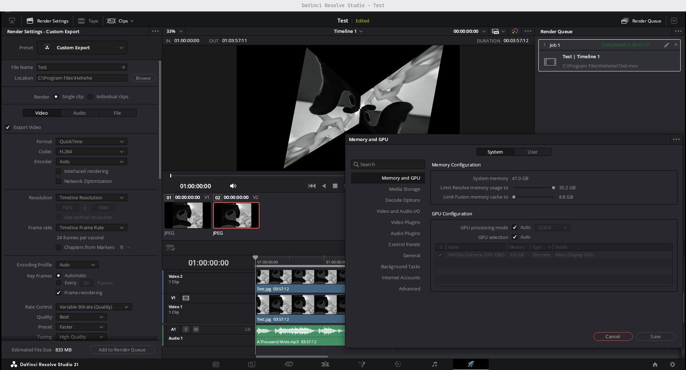

# DaVinci Resolve (Windows) на Linux з CUDA

Запуск **Windows-версії** DaVinci Resolve Studio на Linux через Wine (Bottles, Flatpak) **з робочою CUDA** на відеокарті NVIDIA, щоб можна було користуватися плагінами OFX, які існують лише під Windows.

[English version](README.md)

> **Статус: експериментальний.** Перевірено на одному комп'ютері (див. нижче): Resolve запускається, працює на CUDA, у ньому змонтовано й відрендерено в H.264 простий проєкт (Studio). Тривалу роботу і сторонні OFX-плагіни ще треба ширше тестувати, тож звіти вітаються.



```
GPUDetect          | NVIDIA GPU Driver: 580.99, supports CUDA 13.0
Main.GPUConfig     | Selected compute API: CUDA
GPU.MultiBoardMgr  | Let There Be CUDA Light!
GPU.SingleBoardMgr | Board manager thread for "NVIDIA GeForce GTX 1060" is ready.
```

## Перевірена конфігурація

| Компонент | Версія |
|---|---|
| ОС | LMDE 7 (Debian 13 trixie), ядро 6.12 |
| Відеокарта | GeForce GTX 1060 6GB (Pascal) |
| Драйвер NVIDIA | 580.178.04 (`.run`-інсталятор) |
| Bottles | Flatpak |
| Раннер | soda-11.0-10 |
| Шар CUDA | [SveSop/nvidia-libs](https://github.com/SveSop/nvidia-libs) v1.0.2 |
| Resolve | Studio 21.1.1 (Windows); `setup` також перевірено на чистій пляшці з безкоштовною версією |

> **У Bottles 66.8+ є залежність CUDA.** Вона ставить у пляшку шар CUDA, тобто робить те саме, що тут nvidia-libs, — лише перший крок. Решта виправлень нижче однаково потрібна.

## Чому зазвичай не працює

Додати CUDA у Wine — лише перший крок. Далі Resolve зупиняють ще п'ять речей:

1. **Resolve кладе поруч із собою свій `nvcuda.dll`.** Windows шукає DLL спершу в папці програми, а потім у `system32`, тож Resolve завантажує цей Windows-файл драйвера замість Wine-реалізації з nvidia-libs. Під Wine той не знаходить драйвер, у лозі з'являється `supports CUDA -1.-1`, і Resolve переходить на OpenCL, який під Wine не працює.
   **Рішення:** перейменувати `nvcuda.dll` у папці Resolve.
2. **Bottles може вимкнути `nvcuda`.** Коли в Bottles вмикаєте DXVK-NVAPI, він записує в пляшку `"nvcuda"="disabled"`. Resolve 21 при старті підтягує ланцюжок `llama.dll → ggml.dll → ggml-cuda.dll → nvcuda.dll`, тож із вимкненим `nvcuda` він узагалі не запускається (`c0000135`).
   **Рішення:** скрипт запуску задає `WINEDLLOVERRIDES="nvcuda=n"`, а ця змінна має пріоритет над реєстром.
3. **Версія драйвера.** Resolve 21 вимагає CUDA 12.8, тобто драйвер на хості **580+**. Для Pascal/Maxwell/Volta гілка 580 остання (див. [драйвер 580 на Debian 13](#драйвер-580-на-debian-13--lmde-7-pascal)).
4. **`unimplemented function ucrtbase.dll.cabsf`.** У вбудованій бібліотеці UCRT від Wine немає функції `cabsf()` (модуль комплексного числа), і Resolve падає.
   **Рішення:** справжній `ucrtbase.dll` через `winetricks ucrtbase2019`. Пакет `vcredist2019` з Bottles **не допомагає**: на Windows 10 інсталятор Visual C++ ніколи не ставить UCRT.
5. **Випадковий `c0000005` у `pthreadVC2.dll + 0x3cb3`** одразу після завантаження модулів Fusion (`info[1]=0x198`). Це `pthread_getw32threadid_np()` читає з нульового `pthread_t`: щойно запущений робочий потік питає свій Windows-номер раніше, ніж творець встигає записати його дескриптор. Це гонка потоків, яку виявляє інший порядок старту потоків у Wine.
   **Рішення:** виправлення цієї функції на 13 байт у бібліотеці pthreads-win32 (LGPL), яку постачає Resolve, щоб на нульовому дескрипторі вона повертала 0 замість падіння:
   ```
   було:  mov rax,[rcx] ; mov eax,[rax+0x198] ; ret ; int3 ×6
   стало: mov rax,[rcx] ; test rax,rax ; je +7 ; mov eax,[rax+0x198] ; ret ; ret
   ```
   Скрипт знаходить функцію за шаблоном байтів, виправляє вашу власну копію і зберігає `pthreadVC2.dll.orig`. Жоден бінарний файл тут не поширюється.

### Перевірено й виявилось непотрібним

Під час налагодження ще три речі здавались потрібними, але виявились зайвими (кожну прибирали й перевіряли окремо):

- **NVML** (`nvml.dll`/`nvml.so` з nvidia-libs): Resolve бере з нього додаткову інформацію про відеокарту, але CUDA вибирає і без нього.
- **Записи реєстру відеоадаптера** (`ProviderName`, `Video\Driver`): без них Resolve пише `Failed to find provider information … provider '' driver ''`, але все одно вибирає CUDA.
- **Підміна версії драйвера** (`DXVK_NVAPI_DRIVER_VERSION`): зі справжнім драйвером 580 Resolve бачить `580.99` і приймає його. Знадобиться лише, якщо майбутня версія Resolve вимагатиме новіший драйвер, ніж у вас: тоді впишіть у конфіг `SPOOF_VERSION=58157` (= 581.57).

Справжньою причиною `CUDA -1.-1` був лише вбудований `nvcuda.dll` (пункт 1).

## Що потрібно

- Пропрієтарний драйвер NVIDIA **580+** (`nvidia-smi` показує CUDA ≥ 12.8)
- Flathub-runtime **точно** тієї самої версії, що й драйвер:
  ```bash
  flatpak install flathub org.freedesktop.Platform.GL.nvidia-580-178-04 org.freedesktop.Platform.GL32.nvidia-580-178-04
  ```
  (замініть `580-178-04` на свою версію; `flatpak remote-ls flathub | grep GL.nvidia-580` покаже, які є)
- Bottles з Flathub, пляшка зі свіжим раннером (Wine ≥ 10, наприклад soda 11), у ній встановлений Resolve
- Розпакований архів релізу [nvidia-libs](https://github.com/SveSop/nvidia-libs/releases) (звичайний, не `-fakedll`)

Тут не поширюються жодні файли Blackmagic чи NVIDIA.

## Встановлення

```bash
git clone https://github.com/yarobtw/resolve-wine-cuda.git
cd resolve-wine-cuda
./scripts/resolve-wine.sh setup <НазваПляшки> ~/Downloads/nvidia-libs-v1.0.2
```

`setup` запускається на хості і:

1. перевіряє версію драйвера і відповідний Flatpak-runtime;
2. запускає скрипт nvidia-libs для Bottles (на питання про експериментальний nvapi відповідайте **Y**);
3. перейменовує `nvcuda.dll` Resolve на `nvcuda.dll.resolve-orig`;
4. ставить справжній `ucrtbase` через winetricks (завантажується з офіційного репозиторію) всередині пісочниці Bottles;
5. виправляє `pthreadVC2.dll` (оригінал зберігається як `.orig`);
6. записує `~/.var/app/com.usebottles.bottles/data/resolve-wine.conf` і додає в меню пункт **DaVinci Resolve (Wine)**.

Потім у Bottles відкрийте пляшку → **Settings → Components** і переконайтеся, що встановлено **DXVK**, а **DXVK-NVAPI** = `dxvk-nvapi-v0.9.1`; у **Graphics** увімкніть **DXVK-NVAPI** (і **Discrete Graphics** на ноутбуках з двома GPU). У щойно створеній пляшці цього може не бути.

Запускайте з меню або:

```bash
~/.var/app/com.usebottles.bottles/data/resolve-wine.sh launch
```

Діагностика:

```bash
~/.var/app/com.usebottles.bottles/data/resolve-wine.sh doctor
```

> Запуск звичайною кнопкою в Bottles **не працюватиме**: вона не застосовує правила завантаження DLL.
>
> Запускайте **один** Resolve за раз: кілька копій в одній пляшці блокують базу проєктів і зависають на «Loading Project Libraries». Налагоджувальне логування (`WINEDEBUG=+seh` тощо) помітно гальмує Resolve, тому в скрипті запуску воно вимкнене.

## Вручну, без скрипта

<details>
<summary>Ті самі кроки без скрипта</summary>

1. Поставте nvidia-libs у пляшку їхнім `bottles_setup.sh <Пляшка>`.
2. Перейменуйте `drive_c/Program Files/Blackmagic Design/DaVinci Resolve/nvcuda.dll`.
3. `winetricks ucrtbase2019` у пляшці (з `WINE`/`WINESERVER`, що вказують на раннер).
4. Виправте `pthreadVC2.dll` (шаблон байтів є в скрипті, функція `patch_pthread`).
5. Запускайте в пісочниці (`flatpak run --command=bash com.usebottles.bottles`):

```bash
export WINEPREFIX=~/.var/app/com.usebottles.bottles/data/bottles/bottles/<Пляшка>
RUNNER=~/.var/app/com.usebottles.bottles/data/bottles/runners/<раннер>/bin
WINEDLLOVERRIDES="nvcuda,nvcuvid,nvencodeapi64,nvoptix=n;nvapi64,ucrtbase=n,b" DXVK_ENABLE_NVAPI=1 \
  "$RUNNER/wine" "$WINEPREFIX/drive_c/Program Files/Blackmagic Design/DaVinci Resolve/Resolve.exe"
```
</details>

## Драйвер 580 на Debian 13 / LMDE 7 (Pascal)

Debian 13 постачає 550 (CUDA 12.4), а репозиторій NVIDIA для Debian 13 починається з 590, де Pascal уже не підтримується. Тут спрацював офіційний `.run`-інсталятор:

1. Зробіть знімок у Timeshift.
2. Завантажте `NVIDIA-Linux-x86_64-580.x.run`. Беріть версію, для якої на Flathub є `GL.nvidia-580-…`.
3. Перейдіть у текстову консоль (**Ctrl+Alt+F3**), виконайте `sudo systemctl stop lightdm`.
4. `sudo apt purge '*nvidia*' libcuda1 libnvcuvid1`. Перевірте, що в списку немає пакетів робочого столу.
5. `sudo sh NVIDIA-Linux-x86_64-580.x.run --dkms` → модуль ядра **NVIDIA Proprietary** (open-версія не підтримує Pascal), 32-бітні бібліотеки: так, перебудувати initramfs: так, `nvidia-xconfig`: ні.
6. **Явно заблокуйте nouveau**, інакше після перезавантаження він захоплює карту (`GPU … is already bound to nouveau`):
   ```bash
   printf "blacklist nouveau\noptions nouveau modeset=0\n" | sudo tee /etc/modprobe.d/blacklist-nouveau.conf
   echo "options nvidia-drm modeset=1" | sudo tee /etc/modprobe.d/nvidia-drm.conf
   sudo update-initramfs -u && sudo reboot
   ```

Якщо робочий стіл не запускається: у GRUB натисніть `e`, допишіть `systemd.unit=multi-user.target` у кінець рядка `linux` (у той самий рядок), завантажтесь через **Ctrl+X** і виправте або відкотіть (`sudo nvidia-uninstall && sudo apt install nvidia-driver`).

На Arch nvidia-libs є в AUR як пакет `wine-nvidia-libs-bin`.

## Як підтримувати в робочому стані

| Ви оновили… | Тоді |
|---|---|
| Resolve | Повторіть `setup` (інсталятор може повернути `nvcuda.dll` і оригінальний `pthreadVC2.dll`) |
| Раннер | Повторіть `setup` |
| nvidia-libs | Повторіть `setup` |
| Драйвер NVIDIA | Поставте Flatpak-runtime `GL`/`GL32` точно тієї самої версії |
| Ядро | DKMS перезбере модуль; якщо ні: `sudo dkms autoinstall` |

## Проблеми

| Симптом | Причина |
|---|---|
| `supports CUDA -1.-1`, у `Matches` немає `CUDA` | `nvcuda.dll` поруч із `Resolve.exe` |
| Resolve не стартує, у лозі Wine: `nvcuda.dll (which is needed by ggml-cuda.dll) not found`, статус `c0000135` | Bottles записав `"nvcuda"="disabled"`. `launch` це перекриває, кнопка Bottles — ні |
| `supports CUDA 12.4` (або < 12.8), але `Selected compute API: OpenCL` | Застарий драйвер на хості |
| Зависає на «Loading Fairlight Engine» | Справа не в звуці: впала ініціалізація GPU через OpenCL, див. вище |
| Bottles взагалі не бачить GPU | Версія Flatpak-runtime `GL.nvidia-*` ≠ драйвер хоста |
| У лозі Wine: `unimplemented function ucrtbase.dll.cabsf` | Немає справжнього ucrtbase (`winetricks ucrtbase2019`) |
| Випадковий виліт після модулів Fusion, `c0000005` у `pthreadVC2.dll` | pthreadVC2 не виправлений |
| Зависає на «Loading Project Libraries» | Запущено кілька копій Resolve: `flatpak kill com.usebottles.bottles` і запустіть одну |
| `launch` одразу завершується, нічого не відкривається | Лишились процеси Wine: `flatpak kill com.usebottles.bottles` і запустіть знову |
| Біле вікно при першому запуску (`DaVinci Resolve Welcome.exe`) | Вітальний тур під Wine малюється повільно або білим: зачекайте або закрийте, він показується лише раз |
| Безкоштовна версія: немає H.264/H.265 у Deliver | Безкоштовна Windows-збірка кодує через Media Foundation, якого у Wine немає. Studio кодує через NVENC |

Як самому знайти причину вильоту: запустіть з `WINEDEBUG=-all,err+all,+seh,+loaddll`, візьміть `addr=` винятку `c0000005` і знайдіть модуль, у якого адреса `Loaded … at` найближча знизу.

Логи Resolve лежать у `drive_c/users/<user>/AppData/Roaming/Blackmagic Design/DaVinci Resolve/Support/logs/`. Після закриття Resolve лог переноситься в `LogArchive/ResolveDebug_1.txt` (найсвіжіший).

## Подяки

- [SveSop/nvidia-libs](https://github.com/SveSop/nvidia-libs): nvcuda і dxvk-nvapi для Wine. Без цього нічого б не вийшло.
- [Bottles](https://usebottles.com), Wine, dxvk-nvapi.

## Ліцензія

MIT. DaVinci Resolve — торгова марка Blackmagic Design; NVIDIA і CUDA — торгові марки NVIDIA. Проєкт не пов'язаний з жодною з цих компаній.
